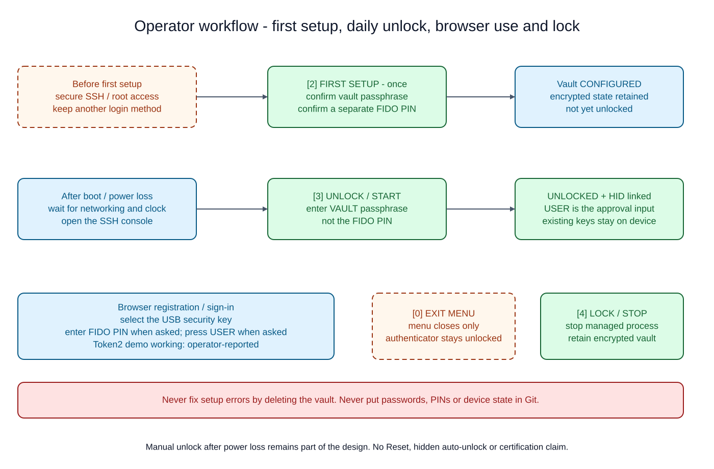
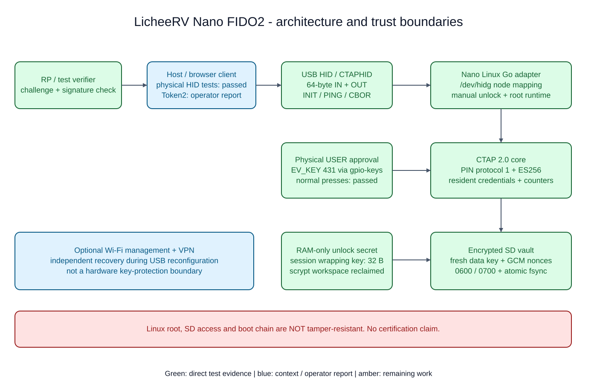
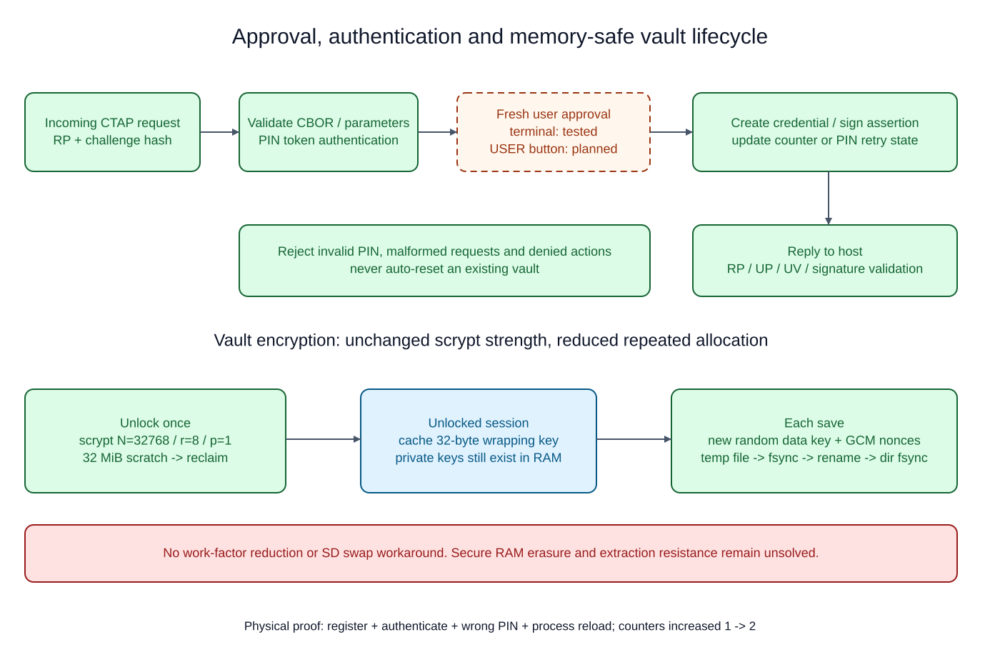
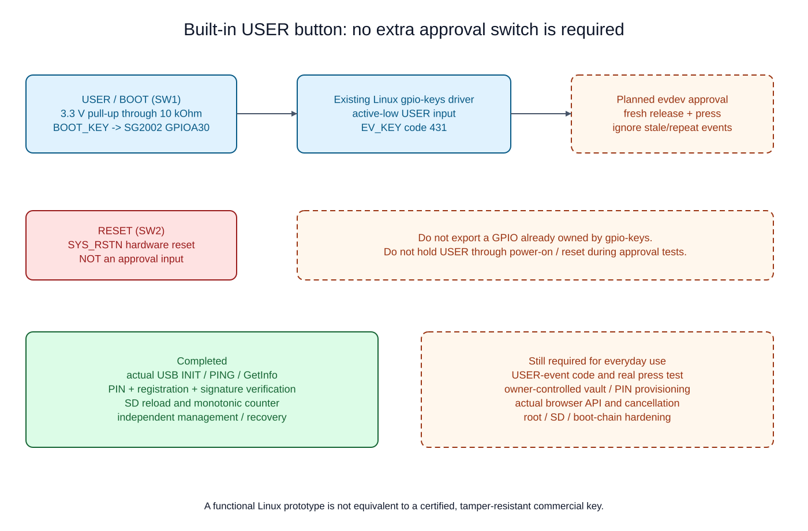

# LicheeRV Nano FIDO2 — experimental USB authenticator

> **Physical USB registration and authentication, including on-board USER approval, passed. Production configuration and security verification are not complete.**
> Do not use this as the only login method for an important account. No FIDO certification, independent security audit, tamper resistance or key-extraction protection is claimed.

This project makes the Nano itself a USB authenticator plugged into a PC. It does not connect another security key to the Nano. A Go authenticator is connected to Linux's HID gadget; the Linux system is not presented as the security boundary of a commercial key.

Snapshots: initial physical tests on 2026-10-13; actual USER approval and configuration-console testing on 2026-10-15. The tested environment was SG2002 / RISC-V C906, Buildroot, Linux 5.10 and Windows 11. Board specifications list 256MB physical DDR, but the tested image exposes about 128MiB to Linux.

## Current status

| Area | Evidence / remaining scope |
|---|---|
| Physical INIT, empty/non-empty PING, canonical GetInfo | Passed |
| PIN protocol 1 and incorrect-PIN rejection | Passed |
| Credential registration and authentication | Passed over real USB |
| Independent RP/UP/UV, packed-attestation and signature verification | Passed |
| Process restart / SD credential, PIN and retry persistence | Passed |
| Old credential authenticates; signature counter 1 to 2 | Passed |
| Linux/SD storage and report helpers | 11 original cases passed; 24 including later USER cases/subtests passed |
| On-board USER approval | Three real presses passed: registration, authentication, authentication after restart |
| Interactive console | Installed; isolated setup/unlock/lock workflow tested |
| English ANSI redesign | Mock-only ANSI/plain, animation/cursor and secret-entry checks passed |
| Token2 browser demo | Operator reported it working; exact browser/options/ceremonies not independently captured |
| Further physical held/repeat/timeout/removal tests | Pending |
| CANCEL, concurrent channels, cold boot, power loss and security review | Pending |

The first physical experiment used three explicit human **terminal** approvals; it is not counted as a button test. The later run used actual USER events, never a matching terminal token or a Windows confirmation click as a substitute.

Experiments used separate synthetic SD vaults and RAM-only passphrases. Their state was disposed and the original USB configuration restored. The console lets the operator separately provision their own state; tests do not choose or inspect owner credentials. Do not infer ready-to-use provisioning or browser compatibility from protocol-test success.

## Start here: operator documentation

- **[Complete user guide](docs/USER-GUIDE.md):** first setup, daily unlock, credential distinctions, USER, browser registration/login, lock/exit, reboot, install, backup and recovery.
- **[Troubleshooting](docs/TROUBLESHOOTING.md):** exact failure messages and safe next steps without deleting credentials.
- [Short console reference](docs/CONFIGURATION.md) and [documentation index](docs/README.md).



## Interactive configuration

After installing the checked `nano/` bundle, open:

```text
ssh -t root@<NANO_HOST> /opt/nano-fido/configure.sh
```

Use a trusted independent management connection. All console prompts/help/errors are English. ANSI terminals get a colored dashboard, grouped controls, a four-step wizard and a short opening animation. No heavyweight TUI dependency is installed. `TERM=dumb` or `NO_COLOR=1` uses plain output; `NANO_UI_NO_ANIMATION=1` disables animation only.

```text
[2] FIRST SETUP       New vault and initial FIDO PIN
[3] UNLOCK / START    Enter vault passphrase; use USER approval
[4] LOCK / STOP       Retain encrypted keys; remove managed HID
[1] STATUS           Read-only service state
[5] GUIDE            Workflow, credentials and safety
[6] DIAGNOSTICS      Metadata only
[0] EXIT MENU        An unlocked authenticator stays running
```

First setup requires `SETUP` or `y`, confirmed vault passphrase and a separate confirmed PIN. Wait for `SETUP COMPLETE` and vault `CONFIGURED`. Unlock takes the **vault passphrase**, not the browser's FIDO PIN. Exiting the menu is not locking.

**Manual vault unlock remains necessary after power loss.** Do not put an auto-unlock passphrase on SD. See [CONFIGURATION.md](docs/CONFIGURATION.md) for install, use and recovery details.

## 1. Architecture and trust boundaries



The Excalimate drawings distinguish direct test evidence, context/operator reports and remaining work. USER approval is implemented and physically tested. The Token2 result is specifically marked as an operator report, not an independently captured compatibility matrix.

```text
RP / verifier -> host FIDO2 client -> USB HID -> Nano Go adapter
                                              |-- CTAP / ES256 / PIN / counters
                                              |-- explicit user approval
                                              `-- encrypted SD vault
```

- **USB:** configfs HID gadget, FIDO usage page 0xF1D0, no report ID, 64-byte IN/OUT reports.
- **Transport:** CTAPHID INIT/PING/CBOR and continuation frames; maximum message size 7609 bytes.
- **Adapter:** maps the actual gadget node, consumes the private pass file and connects approval/storage interfaces.
- **Core:** ES256 credentials, RP-bound lookup, counters, PIN protocol 1, resident credentials and GetNextAssertion.
- **Storage:** encrypted device identity, credential keys, PIN hash and retry count on SD.
- **Recovery:** verified Wi-Fi/VPN or UART/Ethernet independent of USB before changing UDC/configfs. NCM and RNDIS on the same cable are not independent recovery.

Development networking is a management convenience, not protection against extracting FIDO keys. Restrict SSH/root and network exposure separately before any meaningful account trial.

## 2. Approval, PIN and encrypted state



### Three different credentials

| Credential | Purpose |
|---|---|
| SSH authentication | Linux administration |
| Vault passphrase | Decrypt SD state after startup |
| FIDO PIN | Host user verification and PIN-token authorization |

Never commit, log or send real values to chat. They are not designed to be reused.

### Request handling

1. Validate CBOR, required fields, RP and PIN authentication parameters.
2. Wait for the approval required by the operation.
3. Create a credential or sign an assertion and update counters/retries.
4. Persist necessary state before returning the result.

`--button-event` reads the existing gpio-keys device with name/capability/initial-state checks. It opens a fresh descriptor per request and requires a new down following a released state. Repeats/unrelated keys do not approve; dropped events, errors and timeout fail closed. Currently supported targets are 64-bit little-endian Linux. GPIO-value and test-only terminal modes remain, but exactly one mode must be chosen. There is no always-approve deployment mode.

### PIN behavior

- Protocol 1 P-256 ECDH / AES-CBC / HMAC was checked with an independent host implementation.
- Curve identification and fixed-width coordinates/shared secrets preserve leading zero bytes.
- Eight total retries, including blocked zero, persist in the vault.
- Three consecutive failures block the current process/session. Restart clears this session block but does not restore the persisted total.
- A changed PIN invalidates previously issued tokens.

The session block is **not** a hardware-enforced power-cycle boundary. Reset is intentionally rejected. Commercial reset/recovery behavior is not provided.

### Vault and the 128MiB OOM fix

The encryption uses scrypt N=32768/r=8/p=1 and a 32-byte wrapping key. Each save still creates a fresh random data key and AES-GCM nonces. Files/directories must have current-user ownership and modes 0600/0700; the root-only adapter therefore requires root-owned deployment. Saving is temporary file -> file fsync -> rename -> directory fsync.

Wrong passphrases, malformed state and corruption stop processing. Existing ciphertext is not silently deleted or replaced with a new identity. The original vault format is readable; the old missing-retry field is migrated explicitly.

An initial target test was OOM-killed at about 65MiB anonymous RSS because consecutive scrypt workspaces remained resident. The fix caches the session's **32-byte wrapping key** and immediately reclaims temporary KDF workspace; it does not weaken scrypt or spill secrets to SD swap. Old-format and malformed-blob regression tests, selected RISC-V tests and physical USB tests passed afterward.

Private keys, passphrases and cached keys still exist in RAM while unlocked. Go erasure guarantees, root/SD access, boot-chain security and hardware key extraction resistance remain unsolved.

## 3. Built-in USER button



No additional switch is required. The official schematic and running device tree were compared.

| Button | Circuit | Use |
|---|---|---|
| USER / BOOT, SW1 | BOOT_KEY -> GPIOA30, 3.3V/10kOhm pull-up, pressed LOW | Physical registration/authentication approval passed |
| RESET, SW2 | SYS_RSTN hardware reset | Never approval |

The tested image exposes gpio-keys EV_KEY code 0x1af (431). Its node was `/dev/input/event0`, but identify device name/capability rather than assuming this index on every image. Global GPIO numbers also vary. Do not re-export or change the direction of a GPIO already owned by gpio-keys.

USER also has a BOOT role: test short presses after normal startup, not while applying power or holding RESET. Actual negative held/repeat/timeout/removal tests still need expansion beyond state-machine unit cases.

## 4. Software build

Requires Go 1.23+ and Git. The development toolchain was Go 1.27.2.

Windows PowerShell:

```powershell
powershell -NoProfile -ExecutionPolicy Bypass -File .\scripts\build-nano.ps1
```

Linux:

```sh
go mod verify
go test -count=1 ./...
go vet ./...
CGO_ENABLED=0 GOOS=linux GOARCH=riscv64 GORISCV64=rva20u64 \
  go build -trimpath -o out/nano-fido ./cmd/nano-fido
```

The PowerShell policy option affects that process only. The build does not connect to a board or change USB, SSH or vaults. The resulting binary is an authenticator, not the old INIT/PING-only probe. The current configuration-feature suite passed 72 host cases including subtests, host/target vet and the RISC-V build.

This specialized downstream retains Nano-relevant packages from [Virtual FIDO](https://github.com/bulwarkid/virtual-fido), base commit 512d8a3fef0e073171a7ef3261f300e8a5e48694. The original Go module path is kept for internal imports. USB/IP demos and macOS/Windows drivers, test certificates and compiled libraries are excluded. The upstream MIT notice is preserved.

## 5. Tests and evidence

- [Configuration guide](docs/CONFIGURATION.md)
- [Security model](docs/SECURITY.md)
- [Scope-limited physical evidence](docs/TEST-STATUS.md)
- [Publication hygiene review](docs/PUBLIC-AUDIT.md)
- [MCP diagram provenance](docs/diagrams/provenance.json)

Python dependencies stay in a project environment:

```sh
uv venv .venv --python 3.14
uv pip install --python .venv/Scripts/python.exe -r hardware/requirements.lock
```

`hardware/fido_smoke.py` needs Windows administrator approval and explicitly selects the Nano VID/PID. Supply your own target and trusted-host alias; no operational address/password is included. SSH-key authentication is the default; an optional private askpass helper stays outside Git. Host-key verification is never disabled.

```text
python hardware/fido_smoke.py --ssh <SSH_EXECUTABLE> --target <NANO_HOST> \
  --host-key-alias <VERIFIED_KNOWN_HOST> --physical-button --result <LOCAL_RESULT>
```

Inspect/deploy the checked binary and hardware controller, and verify independent recovery before running. It is not a blind installer. Physical mode requires real USER presses; its Windows notice is not an approval. Use the isolated lab path, never an existing owner vault.

All initial physical protocol checks passed, but the original terminal runner ended in needs_review due to cleanup failure. Canonical configfs paths, already-unbound UDC handling, device role and enumeration/DHCP settling were corrected. A separate cycle plus actual USB/VPN SSH reconnected successfully. The later USER runner also passed cleanup. These incidents are described rather than hidden in the test record.

Raw logs, actual addresses/SSIDs, unique device identifiers, account lists, login links and live state are omitted from the public tree. Evidence summaries do not contain credential material.

## 6. Remaining work

1. Further actual held/repeat/timeout/removal USER negative tests.
2. Extend the operator-reported Token2 success into a documented browser/version/option and registration/login matrix, always keeping another login method. The console does not remove manual unlock after power loss.
3. CANCEL during synchronous approval, concurrent-channel isolation, partial-message timeout and in-flight INIT resynchronization.
4. USB reconnect/cold boot/NTP, interrupted SD writes, backup/restore and a deliberate reset policy.
5. Default-administration removal, network exposure restrictions, boot/SD/RAM/key extraction defenses, dependency vulnerability and independent security review.

## 7. Public repository policy

Only selected source, synthetic tests, manifests, authored documentation and diagrams are included. No virtualenv/npm cache, compiled binaries, private settings/helpers, raw logs, vendor PFX/libraries or manufacturer PDFs are committed. A new history and public GitHub noreply author identity were used.

The four drawings were actually created, animated, validated and checkpointed through **Excalimate MCP 0.5.0 over local stdio**. Static SVG snapshots were rendered locally from the returned scenes; editable V2 projects are included. No hosted model or external share tool was called, and no personal network data was sent.

Zero-finding scans and file-by-file checks are not security certification. Review future changes; if something sensitive is exposed, revoke/rotate it and use private communication instead of pasting values into issues.

## References and license

- [Sipeed board/resources](https://wiki.sipeed.com/hardware/en/lichee/RV_Nano/1_intro.html)
- [Sipeed USER input guide](https://wiki.sipeed.com/hardware/en/lichee/RV_Nano/5_peripheral.html)
- [Official 70418 schematic](https://dl.sipeed.com/fileList/LICHEE/LicheeRV_Nano/02_Schematic/LicheeRV_Nano-70418_Schematic.pdf)
- [FIDO specifications](https://fidoalliance.org/specifications/)
- [python-fido2](https://github.com/Yubico/python-fido2)
- [Excalimate](https://github.com/excalimate/excalimate)
- [Virtual FIDO](https://github.com/bulwarkid/virtual-fido)

MIT. Original Virtual FIDO copyright: BulwarkID. Integration modifications are under the same terms. This is not an official product or certification by Sipeed, Yubico, FIDO Alliance, BulwarkID or Excalimate.
