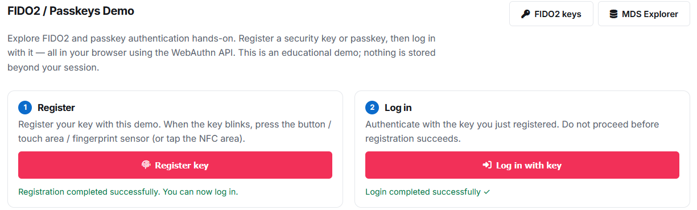

# Test evidence — scope matters

Snapshots: 2026-10-13 terminal approval; 2026-10-15 physical USER approval and operator browser report. Controlled physical/workflow experiments used synthetic state, not owner credentials.

## Operator-reported Token2 browser test

On 2026-10-15 the operator reported that https://www.token2.com/tools/fido2-demo worked with the device, then provided the screenshot below. The agent visually reviewed it: **both registration-completed and login-completed success messages are visible**. It is operator-provided browser evidence, not an independently replayed automated run. Browser/version, selected options, timing and authenticator identity are not visible, so they are not inferred. No PIN, passphrase, credential dump or raw browser log was collected.

The public copy retains the pixels but strips ancillary PNG metadata. [Image review and pinned digest](images/README.md) document its scope and privacy review.

The demo presents registration followed by login through WebAuthn. Its successful use is recorded separately from the independent physical USB/RP-verifier checks below. Broad cross-browser/enterprise-policy compatibility and certification remain unclaimed.

## English ANSI console redesign on 2026-10-15

The menu, all help/errors/setup feedback and configuration documentation were converted to English. A colored status dashboard, grouped controls, four wizard stages, paused detail views and a short opening animation were added. Plain/no-color and no-animation fallbacks remain available, and secret input never animates or echoes.

Four isolated SSH-PTY style checks passed using mock app/service/vault/lock paths: English plain output without ANSI; ANSI dashboard/animation/cursor restoration; cancellation/short/mismatched/confirmed secret entry without echo; fixture lock cleanup. The owner vault and running service were never invoked by these mock tests. Read-only checks of the installed menu preserved the same live authenticator PID and ready marker, with UNLOCKED/HID state unchanged. Only the menu file was atomically replaced, with its prior version backed up.

A local negative launcher check also verified that failed/unconfirmed fixture creation skips cleanup instead of deleting an existing/unknown fixture. Cleanup failures are marked needs_review. This check did not connect to a board. These UI checks do not add browser, cryptographic, hardware-button or power-loss coverage.

## Interactive configuration test on 2026-10-15

The software suite passed 72 host cases including subtests, host/target vet and a RISC-V build. The owner bundle was installed without choosing or creating owner credentials. An isolated SSH-PTY fixture remapped only its vault/service paths to disposable test locations; the actual owner path was required to remain absent.

Six integration checks passed: hidden/confirmed inputs with no secret echo, independent decryption proving the initial PIN hash and empty credential set, TUI and CLI refusal to overwrite existing ciphertext, wrong-passphrase fail-closed/USB restoration with unchanged ciphertext, normal supervised unlock/start/stop with vault retention, and cleanup of runtime/lock markers while the owner vault remained absent. The synthetic test vault was removed afterward. This is not the user's own vault initialization.

The test found and corrected an input-node lookup path and ensured proper daemon detachment from interactive sessions. A readiness marker makes startup success explicit; no raw account/request logs are retained. Real browser compatibility and power-cycle behavior remain separate tests.

## Physical USER test on 2026-10-15

The evdev approval mode passed the complete physical USB flow with **three on-board USER presses**: registration, authentication and authentication after process restart. No terminal approval nonce was sent and the Windows information dialog only indicated when to press; clicking it was not an approval. Strict canonical CBOR/GetInfo, PIN protocol 1, independent RP/UP/UV/packed-attestation/signature checks, wrong PIN/retry decrement, SD reload and counters 1 to 2 passed. The runner status was passed, including automatic cleanup.

The device reader validates the gpio-keys name, USER capability/code 431 and initial key state, and rejects stale/held/repeat/drop/error conditions. Host state-transition tests passed, and all 24 target helper cases including subtests passed; normal physical presses were then tested. Actual held/repeat/timeout/unplug negative tests are still pending. The current publication-source software suite passed 61 cases including subtests, host/target vet and RISC-V cross-build.

Afterward both USB and management SSH were verified; the original network-only USB configuration was configured, the temporary HID and application were stopped, and the disposable SD vault/RAM secret were absent. No live vault was provisioned.

## Before publication

The full development workspace passed 56 host test cases including subtests, host and target go vet, and a Linux/riscv64 rva20u64 static cross-build. The publication tree removes unrelated desktop/USB/IP packages. Its own Windows host build passed **50 cases including subtests**, host/target vet and the RISC-V cross-build; that count is recorded separately rather than assumed to be 56.

Actual Nano Linux/SD execution passed all 11 report/storage helper tests: full/short report I/O, missing/empty vault cases, private modes/owner, atomic replacement, fsync and symlink rejection. Three selected target core tests passed: registration/authentication/reload, PIN changes and token invalidation, and persisted total retries including blocked zero. The core tests use synthetic in-memory support, not live HID credentials.

## Actual Windows USB HID experiment

The client selected only the intended Nano VID/PID. It never called Reset or changed another authenticator. A separate SD test vault and a RAM-only random passphrase were used. The PIN existed only in test-process memory. Three explicit human terminal approval dialogs were accepted; no automatic approval was used.

| Check | Result |
|---|---|
| CTAPHID INIT, empty and non-empty PING | Passed |
| GetInfo and strict canonical CBOR | Passed |
| PIN protocol 1 setup | Passed |
| MakeCredential | Passed |
| Independent RP/UP/UV and packed-attestation validation | Passed |
| GetAssertion and independent signature verification | Passed |
| One incorrect PIN / retries reduced to seven | Passed |
| Authenticator process restart / PIN, retries and SD credential retained | Passed |
| Old credential authenticates after restart / counter 1 to 2 | Passed |
| Correct PIN restores eight retries | Passed |

This is a host-library/RP-verifier experiment over physical USB, **not** proof that a real browser account or all Windows WebAuthn UI paths work.

## Failures were retained and investigated

1. Root's 0077 umask made an intended unsafe-permission fixture private. The test now explicitly chmods its disposable file to 0644. The actual access check was not weakened.
2. An initial target core process was OOM-killed at about 65 MiB anonymous RSS. Session key caching and immediate scrypt workspace reclamation fixed the repeated-allocation pattern without changing the work factor or encrypted vault format.
3. All physical protocol checks passed, but the original runner ended in `needs_review` because its restoration failed. Canonical configfs link checks, idempotent handling of an already-unbound UDC, device-role application and generation-scoped watchdogs were corrected. Manual recovery and a separate activation/restoration cycle were verified. USB enumeration/DHCP required settling before SSH reconnected.

The public record omits raw logs, actual addresses, SSIDs, unique device identifiers, login links and private state. It does not relabel the original runner as having succeeded automatically.

## Final device state after the experiment

The test authenticator was stopped, its temporary HID link removed, original network-only USB configuration restored, and both USB and independent management SSH reverified. The synthetic SD vault and RAM secret were removed. A live vault/PIN and always-on key service were **not** provisioned.

## Not yet verified

A broader independently documented browser/version/option matrix, further physical button negative tests, hardware-enforced power-cycle limits, CANCEL, concurrent channels, cold boot, power loss, exhaustive reconnect/recovery, secure key storage and production security remain outstanding. The operator-reported Token2 success above is not erased by this remaining-work list. USER was only inspected read-only in the original investigation; its normal physical approvals were verified separately on 2026-10-15.
